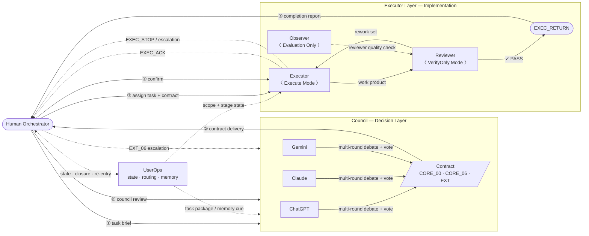
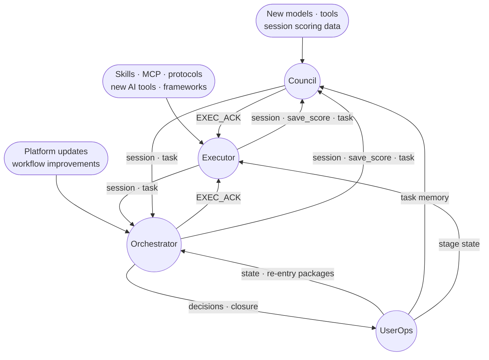

# H.E.L.M — AI Orchestration Workbench

**Human-Executed Layered Multi-model**

Most multi-model AI setups fail the same way: no accountability between models, no handoff discipline when sessions break, no way to verify that outputs actually match the task, and no durable memory of why a task moved the way it did. H.E.L.M solves this with a layered system that keeps decision quality, execution quality, and operational continuity separate, auditable, and resumable.

This is not a prompt template. It is a working system with defined protocols, layered authority, and traceable records built up over 120+ real sessions.

## What One Task Looks Like

You operate three browser Council seats and separate local work sessions. The platform helps dispatch prompts and collect replies; **you remain the link between Council, local work and approval**. UserOps is the local operations steward that keeps the task resumable.

1. **Open the platform and enable ChatGPT, Claude and Gemini.** Start the local platform using the commands below, open its UI, and sign in to the three provider sessions. These are separate model sessions, not shared memory.
2. **Give Council its constitution and a problem.** Load the [Council Constitution](council/COUNCIL_CONSTITUTION.md), then discuss viewpoints, options and tradeoffs. Compare and vote to converge, with one merge owner responsible for the delivery contract. The result is a scoped `core_06.md` file for the local team; voting does not turn an unverified factual claim into truth.
3. **Start UserOps locally and run preflight.** In a fresh local session load [UserOps](userops/USEROPS_CHARTER.md) in normal Task scope. It sets up task state and decision records, checks the contract against actual files, tools and permissions, and records the selected inputs. You route a decision-level mismatch back to Council before implementation.
4. **Bring in an Executor and an independent Reviewer.** Start separate local sessions, assign the two roles, and load the [Executor Charter entry](executors/EXECUTOR_CHARTER.md) in each. It routes them to Common + their own appendix. Cross-model-family review is the default; for example, a ChatGPT Executor and a Claude Reviewer. The Reviewer does not implement the work it accepts.
5. **Read the contract and acknowledge it.** Point both roles at the actual task files and active release. For a Git-tracked contract, provide its commit SHA and path. The Executor returns `EXEC_ACK` with scope, assumptions, evidence expectations and first action; for a formal Council-issued task, confirm that ACK before implementation.
6. **Implement, then independently review.** The Executor works within the approved goal and boundaries. The Reviewer inspects the raw changes and evidence, records a verdict, and gives the complete blocking rework set when needed. Each role writes its own record under `rounds/rN/`; a corrected attempt gets a new round.
7. **Route problems through UserOps and the chair.** Ordinary bugs and in-scope rework stay with the local team. If evidence breaks the contract or a protected boundary must change, UserOps prepares the question and you decide the required Council route. A review preference alone does not create a new task requirement.
8. **Finish and leave a usable record.** Collect the accepted deliverables, Reviewer result, unresolved limits and any owner/trigger for deferred work; confirm closure. UserOps updates the task state and captures reusable lessons. Review PASS, human acceptance and permission to publish remain separate decisions.

The files left behind are practical: a task entry/contract, one current state surface, a decision ledger, and the applicable round submissions/reviews. Records grow only when the task needs them. A small direct chair task can use the lighter entry path without a Council-issued contract; an approved light task has no separate loadout, preflight or Human Briefing file, while retaining its checks and approval boundaries.

## Showcase: WatchOver / AI CI/CD

This CI/CD project is a showcase of HELM in use, from the first requirements and Council discussions to implementation, deployment runs, independent review and public release.

[Open the showcase guide](council/task/ai-cicd/README.md).

The English, translated and redacted records show the actual operating details: decisions, manual message routing, interruptions and recovery, failed checks, rework, W1–W3 experiments, and the Mac-to-Windows handoff. Missing evidence and experimental limitations remain visible.

Follow the [Council conversations](council/task/ai-cicd/sessions/README.md), [Executor and Reviewer records](executors/tasks/ai-cicd/README.md), and [UserOps coordination records](userops/tasks/ai-cicd/README.md), or start with the case timeline and reading guides.

The resulting product is [WatchOver AI DevOps](https://github.com/helmls-studio/watchover-ai-devops).

## Architecture



| Layer | Role | Members |
|---|---|---|
| Council | Debate, vote, produce contracts, final review | ChatGPT · Claude · Gemini |
| Orchestrator | Route, confirm, escalate | Human |
| UserOps | Preserve task state, decision records, closure learning, and re-entry signals | File-backed operations layer |
| Executor | Execute · Review · Observe | Any available model |

## Mutual Optimization Loop

Each layer continuously reviews and optimises the others. External capabilities — new tools, protocols, models — are absorbed at the layer where they are most useful.



No layer operates in isolation. Every layer is accountable to the other two.

## Why The Structure Matters

The interesting part is not that H.E.L.M has three layers. The interesting part is that **the boundaries kept proving useful under repeated real work**.

- The council layer stayed focused on framing, comparison, criticism, and delivery discipline.
- The executor layer kept getting thicker where thickness actually helped: clearer execution states, stronger handoff structure, better verification boundaries, and better traceability.
- The orchestration layer kept more native artifacts instead of relying on memory or paraphrase.
- The operations steward layer turned those artifacts into a durable task-state and learning surface.

That is also why H.E.L.M could absorb ideas from adjacent systems without collapsing into prompt bloat. When outside examples exposed a strong mechanism, H.E.L.M did not need a total rewrite. The underlying layer model was already sound enough to take in targeted improvements with low structural shock.

## What Makes H.E.L.M Different

| Problem | Common approach | H.E.L.M |
|---|---|---|
| AI models give inconsistent outputs | Average or pick one | Structured debate + formal vote |
| Work breaks when session ends | Start over | Handoff protocol — resumable by any executor |
| No way to verify AI output quality | Trust or spot-check | Built-in Reviewer + Observer roles |
| Scope creep in AI tasks | Better prompting | Formal contracts with frozen scope |
| Can't tell why a decision was made | Chat logs | Traceable audit trail per task |
| Repeated tasks lose lessons | More reminders | File-backed memory candidates, traps, routine checks, and closure records |
| Evidence invalidates the plan | Improvise | Explicit Council re-entry path |

## Executor Role Split

H.E.L.M treats the execution side as three distinct roles, not one flat "assistant."

- **Executor** — pushes implementation forward under approved scope
- **Reviewer** — verifies claims against file reality and runnable evidence; read-only
- **Observer** — optional evaluation of blast radius, stage discipline and reviewer quality; it is not required for every task

This role split costs extra tokens. The tradeoff is worth it because it prevents a more expensive failure mode: long debugging loops caused by weak review, blurred authority, or untracked stage drift.

## The Records Are The Asset

One of the strongest parts of H.E.L.M is how much native process data it preserves across 120+ sessions.

- Task folders preserve contracts, review notes, findings, and staged outputs.
- Executor records trace how decisions became actions and how actions were verified.
- Session archives create a replayable history of multi-model deliberation.

That matters because the long-term direction is not "keep the human manually stitching everything forever."

1. A human gives a raw request.
2. A local middle layer compresses, routes, tracks, and preserves it.
3. Council stays focused on judgment.
4. Executors stay focused on delivery.
5. The human remains in control — the orchestration burden gets lighter.

## UserOps Layer

UserOps provides the operational spine between human routing and formal Council/Executor work. The WatchOver showcase now includes a [translated and redacted task record](userops/tasks/ai-cicd/README.md) of that layer in use.

This layer does not vote. It does not implement. It does not overrule review gates. Its job is to keep the system coherent across time:

- task state files for active work
- decision ledgers when the human changes scope or accepts risk
- re-entry warnings when evidence breaks the contract
- closure summaries before context disappears
- memory candidates for reusable lessons
- trap archives for repeatable failure patterns
- routine checks for stale contracts, unclosed tasks, and template drift

That is a major step. H.E.L.M is no longer just a strong council plus a strong executor protocol. It now has a durable UserOps layer that makes the whole system less dependent on one perfect chat window or one perfect human memory.

Public UserOps files:

- [UserOps README](userops/README.md)
- [UserOps Charter](userops/USEROPS_CHARTER.md)
- [UserOps task templates](userops/templates/)

## Local Role-Pack Experiment

H.E.L.M has also tested a local/API-based role-pack path for Council and Executor participants.

The experiment used file-based identity packs, session folders, strict write boundaries, and nonce-based submissions so CLI/API-hosted models could enter the same Council or Executor roles without owning the source system. The result was not a replacement for the main platform, but it proved an important architectural point: H.E.L.M's layer identity can survive a runtime change.

That matters for the next phase. If a model enters through a browser, a terminal, an API-backed CLI, or a future local runtime, the important question is not where the model came from. The important question is whether it can hold the right layer boundary.

Public case notes:

- [Operations stewardship rollout](council/task/operations-stewardship-rollout/README.md)
- [Local role-pack experiment](council/task/local-role-pack-experiment/README.md)

Public structure and prototype entry:

- [H.E.L.M structure map](H.E.L.M_structure.md)
- [Test environment role-pack prototype](test_environment/README.md)

## Current Protocol: Smaller Loads, Clearer Evidence

| Layer | Public edition | Start here |
| --- | --- | --- |
| Council | 1.8 | [Council Constitution](council/COUNCIL_CONSTITUTION.md) |
| Executor / Reviewer | 1.1 | [Executor Charter](executors/EXECUTOR_CHARTER.md) |
| UserOps | 0.6 | [UserOps Charter](userops/USEROPS_CHARTER.md) |

The two local charters now have small, stable entry files and role-scoped packages. An Executor loads Common + Executor; a Reviewer loads Common + Reviewer. UserOps normally loads Task scope; Master is explicitly started for cross-task maintenance and never blocks a task's progress.

Evidence matches the question being answered: commit SHA + paths for Git-tracked baselines, raw bytes/hashes when physical bytes matter or a contract is outside Git, semantic checks for rule preservation, and tests/observation for behavior. Round reports hold the evidence once rather than duplicating manifests. Approved light tasks keep one current state surface and only the records their triggers require; they retain independent acceptance and action approval boundaries.

The Executor owns implementation choices inside approved boundaries. Reviewers distinguish actual blockers from logged improvements and contract questions; ordinary rework continues locally unless scope drifts. Nobody is the sole acceptor of their own work. These are workflow rules, not a claim that a release or live deployment has already been verified.

## Run The Public Platform

```bash
cd user/platform
npm install
npm run ui
```

Regression tests for the reply-capture path (requires a Playwright Chromium install):

```bash
npm test
```

Then open `http://127.0.0.1:3030`.

Local browser login state is intentionally not included in this repository and should stay machine-local.

## Contributors

| | Model | Role |
|---|---|---|
| [](https://github.com/openai) | ChatGPT | Council · Executor |
| [](https://github.com/anthropics) | Claude | Council · Executor |
| [](https://github.com/google-gemini) | Gemini | Council · Executor |

## Public Boundaries

- This is a curated public slice, not the full working archive.
- Private identities, machine-local paths, browser data, and personal operating traces are removed.
- The public naming surface uses `Claude`, `Gemini`, and `ChatGPT`.
- The goal is to show why H.E.L.M works, how the layers cooperate, and how the system has matured — without publishing the full private operating history.
